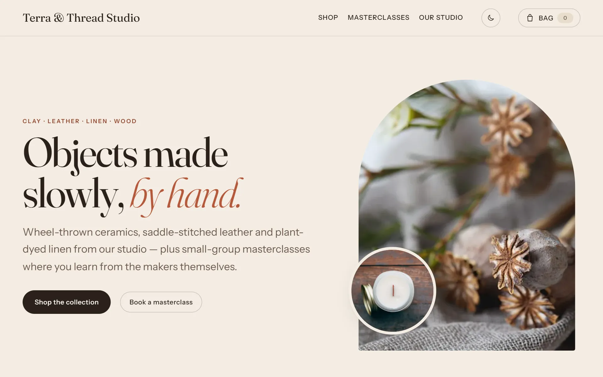
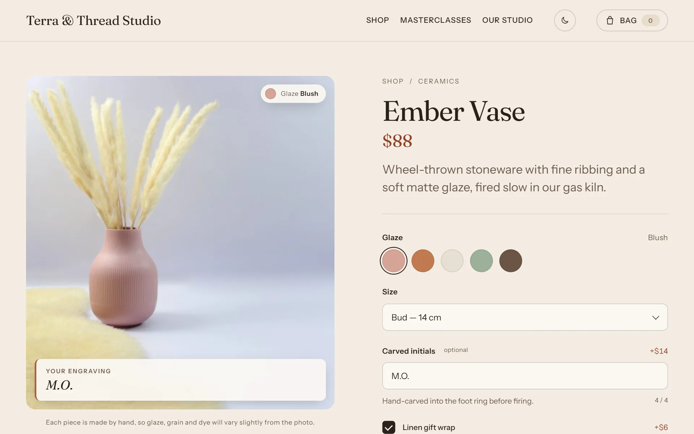
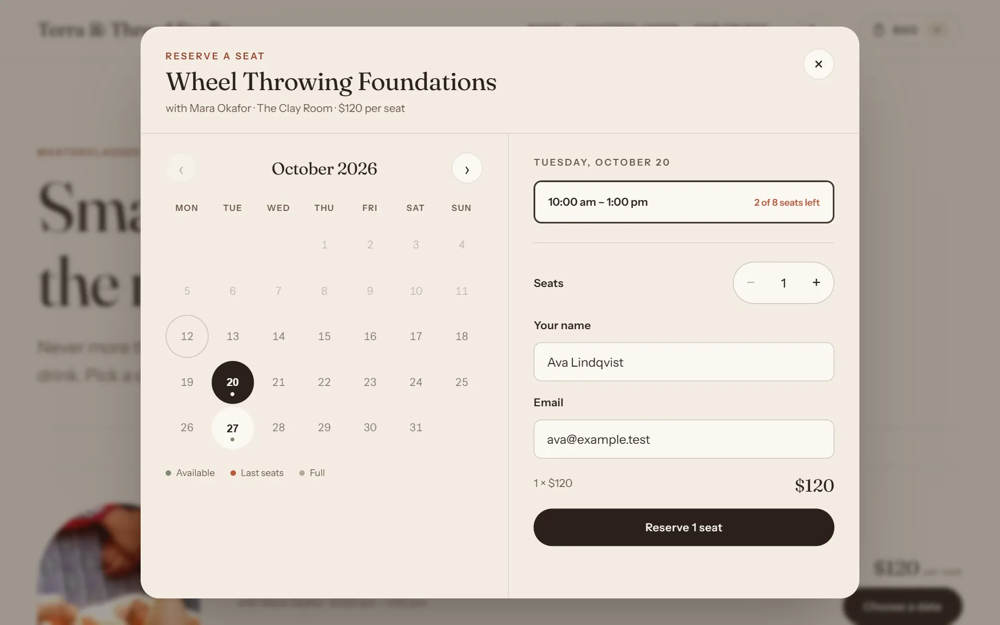

# Terra & Thread Studio

An artisan-studio storefront and workshop-booking site built on **WordPress + SQLite**. There is no MySQL: the whole database is one file. Run it in Docker, or directly on PHP.

**Live demo:** https://terra-thread-studio.vercel.app



- **Shop**: 6 handmade products. Each has custom options (glaze/leather swatches, sizes, engraving, gift wrap). The configurator updates the price as you choose, shows the chosen finish and your engraving over the product photo as you type, and the server checks the price before an item goes in the bag.
- **Masterclasses**: 3 workshops with dated sessions and seat counts. You book through a calendar popup that checks capacity on the server so a session can't be oversold, and the confirmation includes an `.ics` calendar file.
- **Theme**: a custom Full Site Editing block theme in an earthy, editorial style (terracotta, sand and umber colours; Fraunces and Instrument Sans fonts). There is no build step.

<p>
  
  
</p>

## Quick start (Docker)

Requirements: Docker Desktop (Windows/macOS) or Docker Engine with Compose v2 (Linux).

```bash
docker compose up -d            # http://localhost:8090, admin at /wordpress/wp-admin/
docker compose logs web         # first run: shows the generated admin password
docker compose down             # stop (your data stays)
```

One container runs Apache and PHP 8.5, with WordPress 7.1.3 and the SQLite plugin baked into the image. The theme, the core plugin, uploads, `database/`, `config/` and `logs/` are mounted from this folder, so edits show up immediately and the data survives rebuilds. On the first start, with no database yet, the container installs WordPress and seeds the catalogue by itself. Apache gets the same protections as `bin/router.php`, and pretty permalinks.

| Task | Command |
| --- | --- |
| Use another port | set `TT_PORT=9000` in `.env`, then `docker compose up -d` |
| Reset and reseed | `docker compose down`, delete `database/terra-thread.sqlite` and `public/wp-content/uploads/`, then `docker compose up -d` |
| Rebuild after changing the Dockerfile or versions | `docker compose up -d --build` |
| Run PHP inside the container | `docker compose exec -u www-data web php <script>` |

## Quick start (PHP on the host)

Requirements: PHP 8.1+ with `pdo_sqlite`, `mbstring` and `openssl` enabled. Setup downloads WordPress and the SQLite plugin, so it needs internet access. Docker and the host server share the same database file, so run only one at a time (both use port 8090).

**Windows (PowerShell)**

```powershell
powershell -ExecutionPolicy Bypass -File bin/setup.ps1   # download core + SQLite plugin, install, seed
powershell -ExecutionPolicy Bypass -File bin/serve.ps1   # http://localhost:8090
```

**macOS / Linux**

```bash
chmod +x bin/*.sh
bin/setup.sh
bin/serve.sh                                             # http://localhost:8090
```

Setup prints the admin username and a generated password. Admin is at `http://localhost:8090/wordpress/wp-admin/`.

| Task | Command |
| --- | --- |
| Reset the database and uploads, then reseed | `bin/setup.ps1 -Fresh` / `bin/setup.sh --fresh` |
| Use another port | `bin/serve.ps1 -Port 9000` / `PORT=9000 bin/serve.sh` |
| Fixed admin password | set `TT_ADMIN_PASS` before running setup |
| Pin versions | `TT_WP_VERSION=7.1.3`, `TT_SQLITE_VERSION=3.1.0` |

Setup is safe to run again: it only downloads, installs or seeds what is missing. Session dates are set relative to the install date, so the schedule is always in the future. Run `-Fresh` to roll them forward.

## Deploy (static export to Vercel)

WordPress runs only on your computer. Publishing turns it into plain files and uploads them to Vercel, the same way as [jmcastillo-portfolio](https://github.com/johnmichaelcastillo-10/jmcastillo-portfolio):

| | Windows | Linux / macOS |
| --- | --- | --- |
| Build and deploy | Double-click `Deploy.cmd` | `./deploy.sh` |
| Build only | `bin/publish.ps1` | `bin/publish.sh` |
| Preview the build | `node bin/serve-dist.js` → http://127.0.0.1:8099 | same |

Each publish:

1. Moves workshop sessions forward by whole weeks if the next one is under 5 days away, so the live schedule is always upcoming. If the Docker site is running, this runs inside the container.
2. Backs up the database and uploads to `backups/` (deploy only; the newest 10 are kept).
3. Exports with `bin/export-static.php`. It crawls the Docker site if it's running, otherwise a private host server on port 8091, and saves pages, assets and self-hosted Google Fonts. It also writes each workshop's seat availability to `/data/workshops/<id>/sessions.json` and adds a Content-Security-Policy that allows inline scripts only by hash. Nothing is published if any page has a PHP warning or a leftover `localhost` link.
4. Runs `vercel deploy dist --prod`.

**On the static site**, the scripts run in static mode (`window.ttStudio.static`). Prices are calculated in the browser by the same function that mirrors the PHP pricing engine. Reservations are checked against the exported availability and saved in the visitor's browser, and the confirmation says it is a demo. The full WordPress site, with real bookings in SQLite, is what runs locally.

First time on a computer: `npm install -g vercel`, `vercel login`, then `vercel link --yes --project terra-thread-studio --scope kaizerrrs-projects`. Next, copy `.env.example` to `.env` and set `STATIC_URL` to the live address.

## Layout

```
bin/
  setup.ps1 / setup.sh        downloads core + SQLite plugin, installs the drop-in, runs install.php
  install.php                 headless install: salts, wp_install(), activation, schema, seed
  dropin.php                  copies the plugin's db.copy → wp-content/db.php
  serve.ps1 / serve.sh        PHP built-in server
  router.php                  pretty permalinks + blocks dotfiles and direct PHP in wp-content
config/salts.php              generated per checkout (git-ignored)
database/terra-thread.sqlite  the whole database, outside the web root (git-ignored)
public/                       web root
  index.php                   front controller (core lives in /wordpress)
  wp-config.php               DB_ENGINE=sqlite, DB_DIR, custom WP_CONTENT_DIR
  wordpress/                  WordPress core (downloaded, git-ignored)
  wp-content/
    db.php                    SQLite drop-in (generated, git-ignored)
    plugins/
      sqlite-database-integration/   (downloaded, git-ignored)
      terra-thread-core/      ← our data layer
    themes/terra-thread/      ← our block theme
```

### `terra-thread-core` plugin: data and business logic

| File | Role |
| --- | --- |
| `includes/content-model.php` | `tt_product` and `tt_workshop` post types, `tt_material` taxonomy, registered meta |
| `includes/schema.php` | `wp_tt_sessions` and `wp_tt_bookings` tables (MySQL dialect, translated by the SQLite driver) |
| `includes/catalog.php` | product records, option schema normalisation, **`quote()` pricing engine** |
| `includes/bookings.php` | sessions with live seat counts; **transactional `create_booking()`** |
| `includes/rest.php` | `tt/v1` REST API (below) |
| `includes/seeder.php` | demo catalogue, workshops, sessions and a few existing reservations |
| `includes/admin.php` | meta boxes (price/stock/options JSON, sessions), Reservations screen, admin columns |

REST API (`/wp-json/tt/v1/`):

- `GET  workshops/{id}/sessions`: upcoming sessions with `seats_left`
- `POST products/{id}/quote`: `{ options, quantity }` returns the server-side price with line items
- `POST bookings`: `{ session_id, seats, name, email }` returns `{ reference, session }`. Errors: `409` when seats run out, `429` when rate-limited, and a honeypot field rejects bots.

Product options are stored as JSON in `tt_options`, and the same definitions drive both the form and the pricing:

```json
{ "key": "engraving", "label": "Debossed cover text", "type": "text",
  "price": 10, "price_per_char": 0.75, "maxlength": 20 }
```

Types: `swatch` and `select` (choices with `price`, plus `color` for swatches), `text` (`price`, `price_per_char`, `maxlength`) and `checkbox` (`price`).

### `terra-thread` theme: presentation

- `theme.json`: palette, fluid type scale and spacing scale
- `style.css`: theme header plus the component styles
- `functions.php`: asset registration and block registration
- `templates/`: front page, shop archive, material archive, single product, workshop schedule, single workshop, page, index and 404
- `parts/`: header and footer
- `patterns/`: hero, values strip, studio story
- `blocks/*`: dynamic blocks, each a `block.json` plus `render.php`. They are `product-grid`, `product-configurator`, `workshop-schedule`, `workshop-detail`, `bag` and `art`. The editor previews them through ServerSideRender (`assets/js/editor.js`), so no build step is needed.
- `assets/js/`: `studio.js` (bag store and drawer), `configurator.js` and `booking.js`. Each script loads only on pages that use its block.
- `assets/images/`: hero and studio photos used by the patterns
- `assets/art/`: SVG illustrations, shown only when a product or workshop has no featured image

### Photography

Product and workshop photos live in `plugins/terra-thread-core/seed/images/`. The seeder imports them into the Media Library and sets them as featured images, so editors can replace them in wp-admin and setup will never overwrite a replaced photo. The images are cropped to the `tt-portrait` (960×1200) and `tt-thumb` sizes and served with a responsive `srcset`. On the product page, the selected finish appears as a chip on the photo and the engraving appears as a proof card over it. Every photo is CC0 or public domain (StockSnap and Wikimedia Commons), so no credits are needed on the site; sources are listed in [`seed/images/CREDITS.md`](public/wp-content/plugins/terra-thread-core/seed/images/CREDITS.md).

## Notes

- **Checkout is not connected.** The bag is kept in the browser's `localStorage` with server-verified prices, and the checkout button explains that this is a demo. To add payments, have checkout call `quote()` for each line and pass the totals to a payment provider.
- Booking confirmation emails go through `wp_mail()`. Local machines usually have no mail server, so sending fails quietly and the booking still saves.
- `router.php` is only for the PHP development server. In production, use Apache or nginx with standard WordPress rewrites and keep `database/` outside the web root as it is here.
